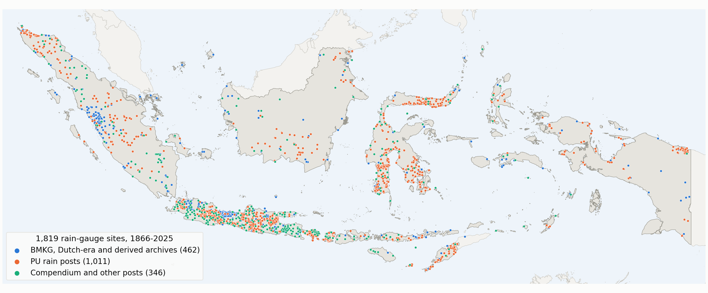

# wxgrid

Daily rainfall observed at rain gauges and climate stations across Indonesia, gathered from national
workbooks, provincial rain-post forms, river-basin archives, and regional and global collections into one
consistent dataset.

## What is happening now

The current work is **compiling the station record**. Each archive holds a piece of Indonesia's daily
rainfall, and each writes missing days, trace rain and dry days in its own way, labels the day differently,
and sometimes carries a copy of another station's data. wxgrid reads them all and brings them together
**as observed**:

- values are never changed; each source's codes are decoded by its own rules
- problems are flagged, not deleted
- dates are aligned to one convention (24 hours ending 07:00 local, labelled with the end date)
- the same gauge found in several archives is linked into one site
- every decision is written down with the measurement behind it

The current release covers **1866 to 2025**: **6,814,478 site-days at 1,819 sites**. Nothing is
interpolated and nothing is homogenised: every value is an observation at a site. Sources are still being
added and checked.

## Future plan

| Next | State |
|---|---|
| Daily rainfall grid over Indonesia, following documented international practice | Planned, not started |
| Rainfall zones from CHIRPS or TerraClimate | Planned, not started |
| Other elements (temperature, humidity, wind) where sources carry them | Read where available, not yet released |

## More detail

| Page | What |
|---|---|
| [data/](data/) | Draft release: long and wide tables, site table and its README |
| [docs/sources.md](docs/sources.md) | Every archive read, and where it comes from |
| [docs/pipeline.md](docs/pipeline.md) | How the dataset is built, how to run it, requirements, repository layout |
| [docs/station-dataset.md](docs/station-dataset.md) | The compiled dataset: files, columns, flags and rules |
| [docs/findings.md](docs/findings.md) | Measured properties of the data, each with the script behind it |
| [docs/references.md](docs/references.md) | Reference registry for every method or dataset claim |

The draft release is copied to [data/](data/) on every export. Raw and compiled data stay outside the
repository, and each source keeps its own terms of use.

## Working rules

- Every method choice and dataset fact traces to a reference or to a script that measured it; anything not
  yet checked is marked `[to verify]`.
- Raw station data is read-only; cleaned or derived data goes to new, clearly named files.

## Licence

Code: [Mozilla Public License 2.0](LICENSE). Station data and derived products are not covered by this
licence; they keep the terms of their sources.
